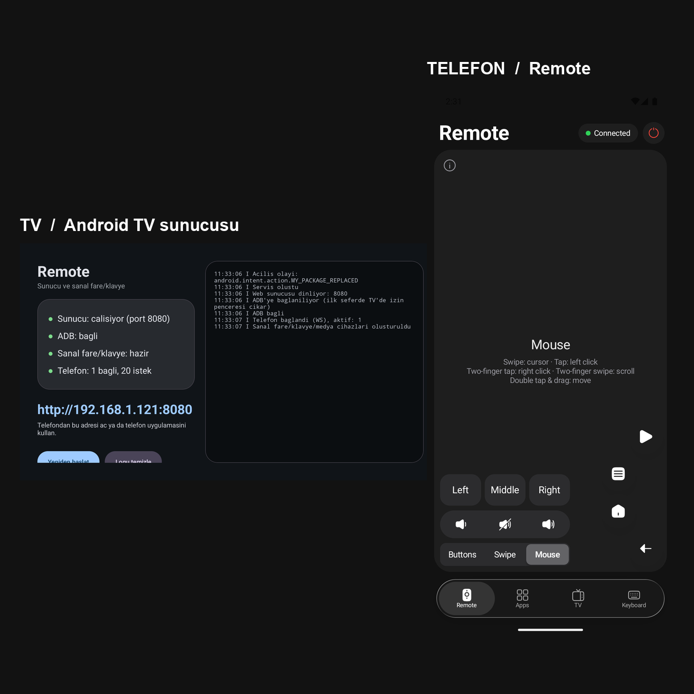

# Remote

Control an Android TV from your phone. Two parts: a server app running on the TV and a remote app on the phone. No PC or Termux required, and no hardcoded IP address.



## Parts

- [`tv/`](tv/README.md) — Android TV server (`com.lowell.tvremote`). HTTP/WebSocket on port 8080, virtual HID mouse/keyboard/media, auto-install over wireless ADB. UI is available in **Turkish (default)** and **English** via the language button on the TV screen. Background logs stay in Turkish.
- [`phone/`](phone/README.md) — Phone remote (`com.lowell.tvkumanda`). Compose UI, TR/EN, light/dark/system theme, touchpad + gestures, live keyboard.

## Quick start

1. Enable **Wireless debugging** on the Android TV (approve the ADB prompt once).
2. Connect the phone and the TV to the same Wi-Fi network.
3. Build and install both apps with one command:

```
powershell -ExecutionPolicy Bypass -File .\phone\deploy.ps1
```

For a different TV address:

```
powershell -ExecutionPolicy Bypass -File .\phone\deploy.ps1 -TvIp 192.168.X.Y:5555
```

To change the launcher icon on both apps:

```
powershell -ExecutionPolicy Bypass -File .\phone\set-icon.ps1 -Icon custom
```

Options: `dark`, `solar`, `mono`, `custom` (currently active: round custom).

## How discovery works

The TV server listens on all interfaces on port 8080 and shows its LAN address on screen. On first launch the phone scans the same `/24` subnet via `/status`; if nothing is found, use Settings → TV → Scan TV. There is no fixed IP in the code.

## Language notes

- TV app: use the **English / Türkçe** button on the main screen; the choice is saved.
- Phone app: Settings → Language / Dil (Auto / Türkçe / English). Default is English.
- Internal logs and comments remain Turkish by design.

## License

MIT — see [LICENSE](LICENSE). Internal project notes are in Turkish.
