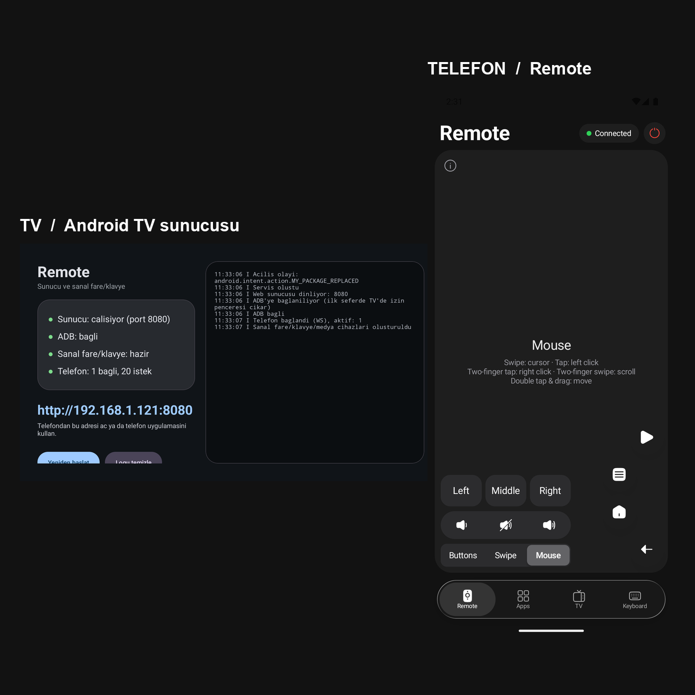

# Remote — Android TV sunucusu



Telefondaki **Remote** uygulamasına bağlanan Android TV sunucusu. PC veya Termux gerekmez; TV kendi HTTP/WS sunucusunu (8080) ve sanal HID cihazlarını (fare / klavye / medya) barındırır.

## Kurulum
- Android TV'de **Kablosuz hata ayıklama** (Wireless debugging) açık olmalı; ADB izni bir kez onaylanır.
- `build/outputs/apk/debug/app-debug.apk` dosyasını TV'ye kur:
  `adb connect <TV_IP>:5555`
  `adb -s <TV_IP>:5555 install -r app\build\outputs\apk\debug\app-debug.apk`
- Uygulama açılışta sunucuyu başlatır, ekranda kendi LAN adresini gösterir (örn. `http://192.168.1.50:8080`). Sunucu tüm arayüzlere bind olur; sabit IP yok.

## Telefon tarafı
Aynı ağdaki telefon uygulaması TV'yi otomatik tarar; gerekirse Ayarlar → TV → TV'yi ara ile bulur. Tek depo: `Lowell137/Remote` (klasörler `tv/` + `phone/`).

## Tek komutla dağıtım
Telefon projesindeki `deploy.ps1` iki APK'yı da derleyip TV + telefon + isteğe bağlı emülatöre kurar:

```
powershell -ExecutionPolicy Bypass -File .\deploy.ps1 -TvIp 192.168.X.Y:5555
```

İkon değiştirme (TV + telefon birlikte): `set-icon.ps1 -Icon dark|solar|mono|custom`.

## İzinler
INTERNET, ACCESS_NETWORK_STATE, WAKE_LOCK, FOREGROUND_SERVICE, RECEIVE_BOOT_COMPLETED, ADB (UHID) ve klipboard yapıştırma.
